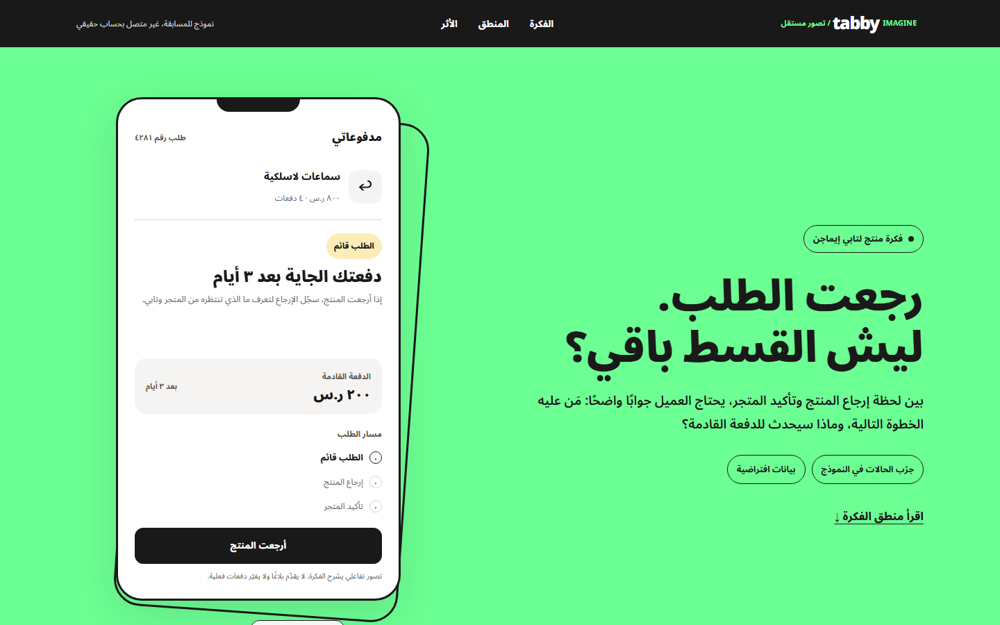
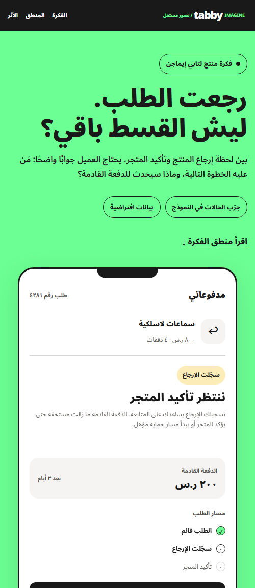

# وين وصل إرجاعي؟

### رجعت الطلب. ليش القسط باقي؟

تصوّر تفاعلي مستقل لمسابقة **Tabby Imagine** يوضّح رحلة الإرجاع بين العميل، المتجر، وتابي.

[جرّب النموذج](https://faisald2926.github.io/tabby-IMAGINE/) · [تواصل مع فيصل](https://www.linkedin.com/in/faisal-aldawood1/)

## الفكرة في دقيقة

العميل قد يعيد المنتج بينما يظل قسطه القادم ظاهرًا؛ لأن معالجة الاسترداد في تابي تبدأ بعد أن يسجّل **المتجر** الإرجاع. المشكلة هنا هي غموض الحالة والخطوة التالية، لا مجرد غياب زر إلغاء.

يقترح النموذج حالة واضحة على مستوى الطلب تفرق بين:

| المرحلة | ماذا يرى العميل؟ | أثرها على الدفعات |
| :--- | :--- | :--- |
| سجّل العميل الإرجاع | ننتظر تأكيد المتجر، مع توضيح جهة المتابعة | تبقى الدفعة كما هي |
| تأخر المتجر | خطوة تصعيد إلى حماية المشتري عند الأهلية | البلاغ المؤهل قد يعلّق الجدول أثناء التحقيق |
| أكّد المتجر الاسترداد | جدول محدّث وما سيُعاد إلى وسيلة الدفع | تُعدّل الدفعات بحسب الاسترداد الفعلي |

> **مهم:** تسجيل الإرجاع داخل هذا التصوّر لا يوقف الدفعات بحد ذاته. الحالات والمبالغ في النموذج افتراضية، والواجهة لا تتصل بحساب تابي حقيقي.

## من النموذج

  

اضغط **«أرجعت المنتج»** ثم جرّب مساري **تأكيد المتجر** و**عدم تجاوبه**. زر **«شاهد رحلة سريعة»** يعرض الحالات تلقائيًا. ويمكن فتح حالة مباشرة بإضافة `?state=returned` أو `?state=confirmed` إلى الرابط.

## لماذا هذه الفكرة؟

- توضّح مصدر كل حالة: تصريح العميل، تأكيد المتجر، أو بلاغ مؤهل لدى تابي.
- تجيب عن سؤال المستخدم الأهم: **هل القسط القادم ما زال مستحقًا، ومن عليه الإجراء الآن؟**
- تتعامل مع الحالات الحساسة بوضوح؛ مثل الاسترداد الجزئي ورصيد المتجر الذي لا يغيّر دفعات تابي تلقائيًا.
- تقترح قياس النجاح بانخفاض استفسارات «وين استردادي؟» لكل ألف طلب مُرجع قبل تأكيد المتجر، مع مراقبة تأخر السداد والبلاغات غير المؤهلة.

الصفحة تتضمن آلة تقدير تفاعلية تستخدم **٥٫٥ مليون عميل نشط في السعودية من تصريح منشور عام ٢٠٢٤** ونسبة افتراضية قابلة للتغيير. الناتج سيناريو للنقاش وليس رقمًا حديثًا أو قياسًا من تابي.

## التشغيل محليًا

المشروع صفحة ثابتة، بلا تثبيت حزم أو خادم خلفي. افتح [`dist/index.html`](dist/index.html) في المتصفح. الواجهة عربية ومتجاوبة، وتدعم `prefers-reduced-motion`.

## مصادر القرار

- [تابي: أين استردادي؟](https://tabby.sa/en-SA/help/help-orders/where-is-my-refund)
- [تابي: كيف ومتى أستلم المبلغ؟](https://tabby.sa/en-SA/help/help-orders/how-and-when-will-i-receive-my-refund)
- [تابي: ماذا يحدث بعد الإبلاغ عن مشكلة؟](https://tabby.sa/en-SA/help/help-orders/what-happens-after-ive-reported-an-issue)
- [مصدر رقم العملاء التاريخي](https://www.argaam.com/en/article/articledetail/id/1752602)
- [دليل هوية تابي](https://brand.tabby.ai/)

---

**صاحب الفكرة:** [فيصل الداود](https://www.linkedin.com/in/faisal-aldawood1/) · Concept by Faisal Al-Dawood. This is an independent, non-official Tabby Imagine submission.
